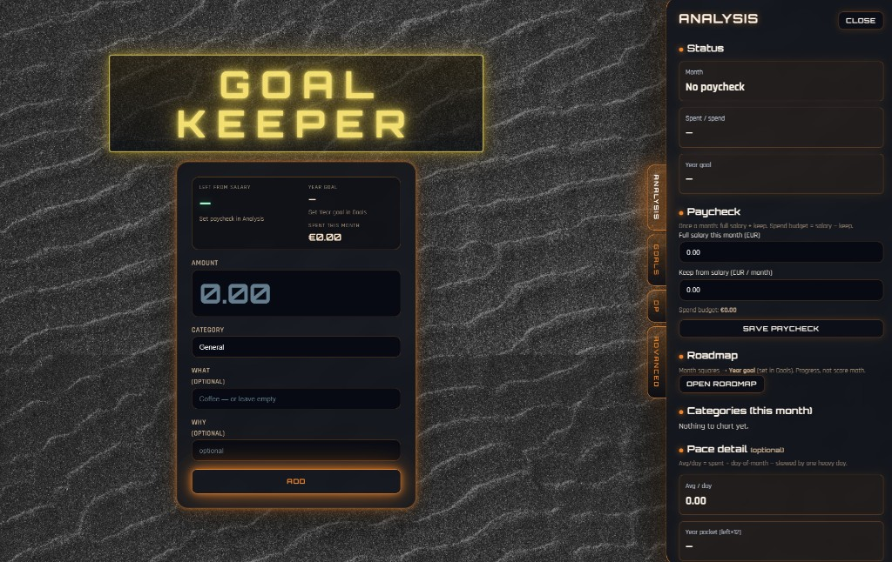
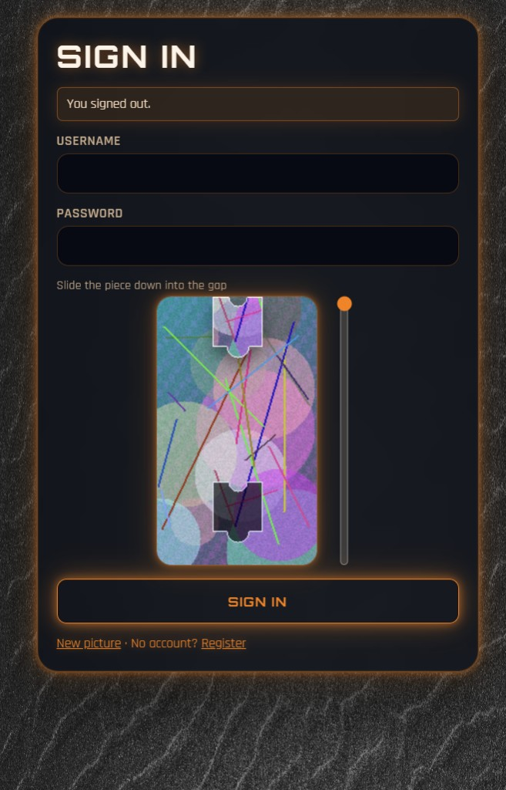
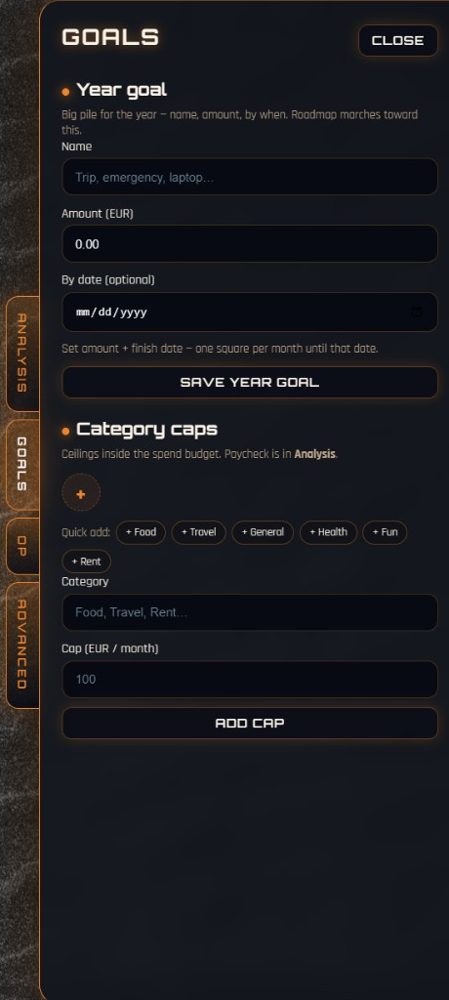
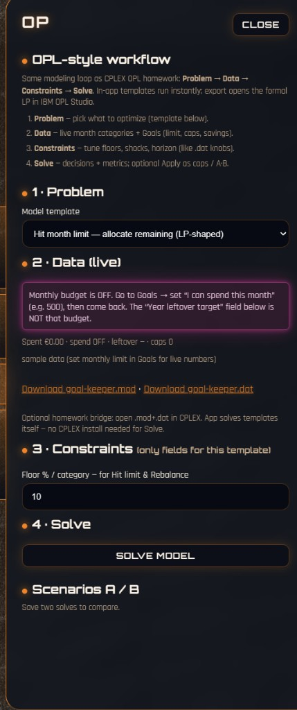
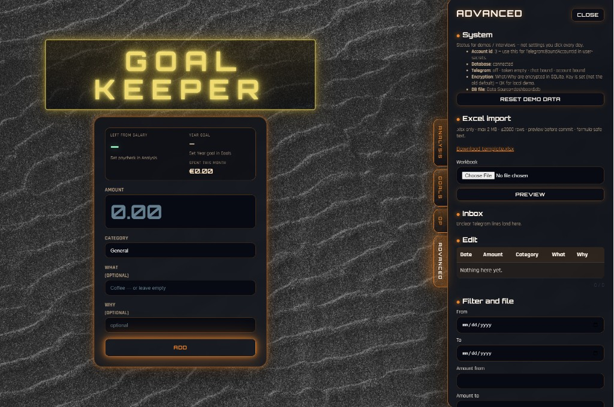

# Goal Keeper

Neon cyber expense dashboard on ASP.NET Core — fast spend entry, Goals, Analysis, OP templates, Excel import with a security gate, and an optional Telegram inbox.

Portfolio evolution of [Dashboard](https://github.com/Galustjans-Artjoms/Dashboard) ·  
repo: [Galustjans-Artjoms/Goal-Keeper](https://github.com/Galustjans-Artjoms/Goal-Keeper)



<p align="center">
  
  &nbsp;
  
  &nbsp;
  
</p>



## Features

| Area | What it does |
|------|----------------|
| **Face form** | Add a spend (Amount / Category / What / Why); see spent / leftover immediately |
| **Analysis** | Paycheck (salary − keep = spend budget), roadmap, month categories |
| **Goals** | Year goal + category caps |
| **OP** | LP-style templates (hit limit / cut to green…) → Solve, A/B scenarios, export `.mod` / `.dat` |
| **Advanced** | Excel import, Inbox, filters, System (DB / Telegram status / Reset demo) |
| **Telegram** | Message an amount to the bot → transaction or Inbox *(while the API is running)* |

## Stack

- .NET 10 · ASP.NET Core MVC + API  
- EF Core · SQLite  
- Cookie auth · AES for What/Why  
- ClosedXML · Telegram long-poll (optional)

## Requirements

- [.NET 10 SDK](https://dotnet.microsoft.com/download)  
- (optional) a bot from [@BotFather](https://t.me/BotFather)

## Setup & run

```powershell
git clone https://github.com/Galustjans-Artjoms/Goal-Keeper.git
cd Goal-Keeper

cd Dashboard.Api
dotnet user-secrets set "Encryption:Key" "your-16-plus-char-key"
cd ..

dotnet run --project Dashboard.Api --launch-profile http
```

Open **http://localhost:5011**

1. **Register** — create an account (password ≥ 8 chars), solve the puzzle captcha  
2. **Sign in**  
3. Right-side tabs: **Analysis** (set paycheck) · **Goals** · **OP** · **Advanced**  
4. **Advanced → Reset demo data** — optional sample spends  
5. On the face form, press **ADD**

Health check: `GET http://localhost:5011/health`

## Secrets (do not commit)

`appsettings.json` keeps Telegram and Encryption fields **empty on purpose**. Use user-secrets only:

```powershell
cd Dashboard.Api
dotnet user-secrets set "Encryption:Key" "your-16-plus-char-key"
dotnet user-secrets set "Telegram:BotToken" ""
dotnet user-secrets set "Telegram:AllowedChatId" "0"
dotnet user-secrets set "Telegram:BoundAccountId" "0"
```

- Never put a live bot token in git / README / screenshots.  
- If a token was ever exposed — BotFather → **Revoke**, then set the new one via user-secrets.  
- `dashboard.db` is gitignored.  
- `BoundAccountId` is shown under **Advanced → System** after login.

Details: [TELEGRAM.md](TELEGRAM.md).

## Telegram (short)

1. BotFather → token → `Telegram:BotToken`  
2. Start the API → message the bot `/start` → set `AllowedChatId`  
3. Set `BoundAccountId` from Advanced → System  
4. Send lines like: `4.50 coffee late for train`  

The bot only runs while `Dashboard.Api` is running.

## Tests / CI

```powershell
dotnet test
```

GitHub Actions: `.github/workflows/ci.yml`.

## Architecture

```text
Face form ──► Transactions ──► Forecast / Goals / Analysis
Excel ──► Security gate ──► Preview ──► Commit
OP templates ──► caps / leftover ──► Solve · A/B · .mod/.dat
Telegram ──► ledger / Inbox
```

## API

`GET/POST/PUT/DELETE /api/transactions` (cookie auth).  
Filters: `fromDate`, `toDate`, `minAmount`, `maxAmount`, `category`, `descriptionContains`.

## Security talking points

- Per-account isolation for ledger / budget / inbox / imports  
- Excel: `.xlsx` only, size/row caps, preview before commit  
- Login throttle + puzzle captcha · security headers · encryption at rest  
